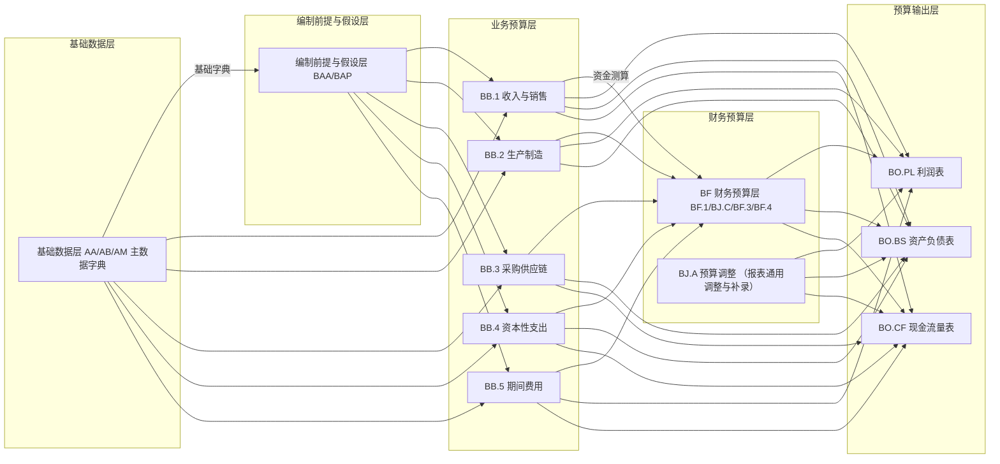
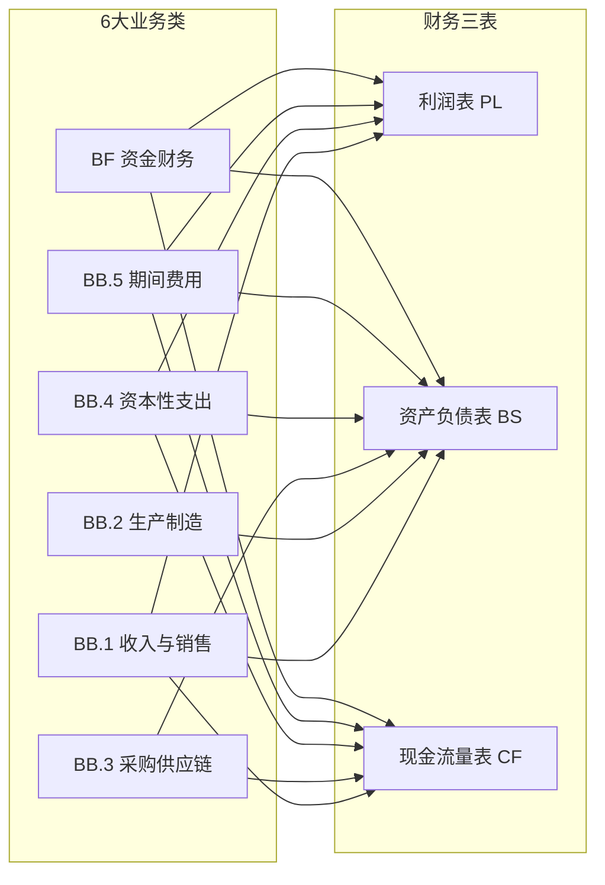
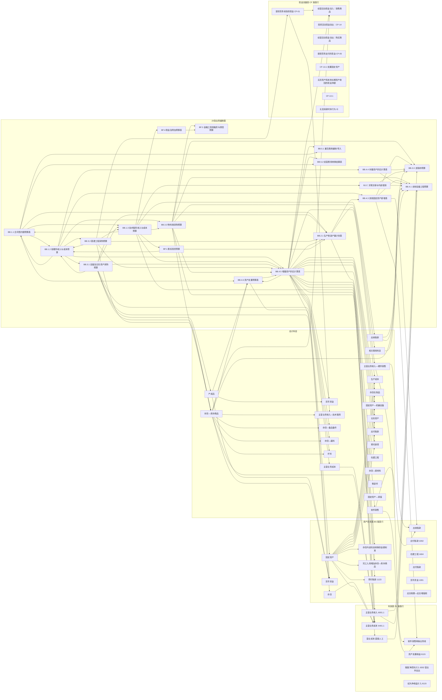

# A1.3 总体逻辑与关系图

## ① 总体逻辑与关系图

内部 A/B/C/D/E 五张图，粒度递增、互为姊妹图；均不生成分录，属集团整体口径、不按法人编制。图用 mermaid 代码块表达（由阅读方编辑器渲染），失去原交互式的缩放/点击高亮。

### A 全面预算编制整体逻辑图（CFO 汇报版）

管理层汇报专用简化版：只画「模块级依赖」（基础数据 → 编制前提与假设（BAA/BAP）→ 业务预算 → 财务预算（BF.1~BF.4）→ BO 三表），BO 三表在「业务预算 + 财务预算 + BJ.A 预算调整」三个上游来源基础上汇总生成；不涉及会计科目/借贷分录/字段级引用。

### B TAB 级别表单 ER 图

```mermaid
flowchart LR
  subgraph sg0["A 基础主数据"]
    n0["AA.1 预算年度与期间"]
    n1["AA.2 法人组织架构"]
    n2["AA.3 统一科目体系"]
    n3["AA.4 客户主数据"]
    n4["AA.5 行政部门"]
    n5["AA.6 预算项目主数据"]
    n6["AA.7 预算产品主数据"]
    n7["AA.8 管理单元主数据"]
    n8["AA.9 资产类别与折旧"]
    n9["AA.10 供应商主数据"]
    n10["AA.11 物料主数据"]
    n11["AB.1 项目与研发字典"]
    n12["AB.2 国资委行业字典"]
    n13["AB.3 产品类别（财务口径）字典"]
    n14["AB.4 收入确认方式字典"]
    n15["AB.5 合同性质字典"]
    n16["AB.6 物料好坏件字典"]
    n17["AB.7 预算项目类型字典"]
    n18["AB.8 客户类型业务字典"]
    n19["AB.9 存货物料类别字典"]
    n20["AB.10 资产账簿字典"]
    n21["AB.11 岗位字典"]
    n22["AB.12 职级字典"]
    n23["AB.13 授信类型字典"]
    n24["AB.14 费用属性字典"]
    n25["AB.16 租赁期限字典"]
    n26["AB.17 融资类型字典"]
    n27["AB.15 税率及附加税比率字典"]
    n28["AM.1 产品与收入方式映射"]
    n29["AM.2 部门属性映射表"]
  end
  subgraph sg1["BA 编制前提与假设"]
    n30["BAA.2 产品标准成本设置"]
    n31["BAA.3 岗位工时费率设置"]
    n32["BAA.4 服务物料定额标准"]
    n33["BA.5 费用预算汇总表"]
    n34["BAP.2 物料消耗需求汇总表_常规"]
    n35["BAP.3 物料消耗需求汇总表_研发长期"]
    n36["BAA.6 办公场所租赁维护"]
    n37["BAA.7 采购付款额测算比例附表"]
    n38["BAA.8 经营费用转换比例表"]
    n39["BAA.9 资本性支出拆分比例表"]
    n40["BAA.10 进销存按法人拆分比例表"]
    n41["BAA.11 关联交易加成比例"]
  end
  subgraph sg2["BB 业务预算"]
    n42["BB.1.1 合同签约额预算表"]
    n43["BB.1.2 软硬件收入与成本预算"]
    n44["BB.1.3 技术服务收入与成本预算"]
    n45["BB.1.4 销售费用预算明细表 (经营)"]
    n46["BB.2.1 生产制造产量计划表"]
    n47["BB.3.1 设备及无形资产采购预算"]
    n48["BB.3.2 基建工程采购预算"]
    n49["BB.3.3 物料类采购预算"]
    n50["BB.3.X 进销存预算"]
    n51["BB.4.1 自制设备工程预算"]
    n52["BB.4.2.a 外部职场租赁"]
    n53["BB.4.2.a.1 外部职场租赁·财务视角"]
    n54["BB.4.2.b 内部职场租赁"]
    n55["BB.4.2.b.1 内部职场租赁·财务视角"]
    n56["BB.4.3 其他固定资产新增表"]
    n57["BB.4.4 存量资产折旧计算表"]
    n58["BB.4.5 增量资产折旧计算表"]
    n59["BB.4.6 资产处置预算表"]
    n60["BB.4.X 资本性支出汇总表"]
    n61["BB.5.1 雇员费用编制/导入"]
    n62["BB.5.2 经营费用转换结果表"]
    n63["BB.1.X 销售预算多维汇总分析 (经营)"]
  end
  subgraph sg3["BF 资金财务"]
    n64["BF.1 股权投资预算"]
    n65["BF.3 金融工具投融资与授信预算"]
    n66["BF.4 税金及附加预算表"]
    n67["BJ.C 关联交易与内部抵销"]
    n68["BJ.C.R 集团合并抵销规则"]
  end
  subgraph sg4["BO 预算输出"]
    n69["BO.PL 损益表"]
    n70["BO.BS 资产负债表"]
    n71["BO.CF 现金流量表"]
    n72["BO.ELIM 集团合并抵销工作底稿"]
  end
  n15 --> n42
  n3 --> n42
  n5 --> n42
  n6 --> n42
  n4 --> n42
  n1 --> n42
  n13 --> n42
  n28 --> n42
  n14 --> n42
  n5 --> n43
  n6 --> n43
  n4 --> n43
  n3 --> n43
  n16 --> n32
  n10 --> n32
  n4 --> n44
  n5 --> n44
  n6 --> n44
  n3 --> n44
  n18 --> n44
  n28 --> n44
  n14 --> n44
  n13 --> n44
  n9 --> n44
  n16 --> n44
  n10 --> n44
  n6 --> n45
  n3 --> n45
  n5 --> n45
  n4 --> n45
  n1 --> n36
  n5 --> n37
  n4 --> n37
  n5 --> n38
  n4 --> n38
  n33 --> n38
  n29 --> n38
  n5 --> n39
  n4 --> n39
  n8 --> n39
  n5 --> n40
  n4 --> n40
  n5 --> n34
  n4 --> n34
  n10 --> n34
  n19 --> n34
  n4 --> n35
  n10 --> n35
  n19 --> n35
  n1 --> n46
  n4 --> n46
  n6 --> n46
  n5 --> n48
  n4 --> n48
  n1 --> n48
  n9 --> n48
  n8 --> n48
  n1 --> n50
  n19 --> n50
  n46 --> n50
  n61 --> n50
  n62 --> n50
  n43 --> n50
  n44 --> n50
  n1 --> n64
  n27 --> n66
  n43 --> n66
  n44 --> n66
  n47 --> n66
  n48 --> n66
  n49 --> n66
  n56 --> n66
  n62 --> n66
  n1 --> n61
  n5 --> n61
  n4 --> n61
  n44 --> n61
  n51 --> n61
  n5 --> n51
  n1 --> n51
  n4 --> n51
  n10 --> n51
  n19 --> n51
  n8 --> n51
  n5 --> n56
  n1 --> n56
  n4 --> n56
  n8 --> n56
  n5 --> n58
  n4 --> n58
  n47 --> n58
  n48 --> n58
  n51 --> n58
  n56 --> n58
  n67 --> n58
  n8 --> n58
  n1 --> n59
  n4 --> n59
  n8 --> n59
  n5 --> n60
  n4 --> n60
  n8 --> n60
  n14 --> n13
  n6 --> n28
  n14 --> n28
  n4 --> n29
  n24 --> n29
  n1 --> n62
  n5 --> n62
  n4 --> n62
  n29 --> n62
  n33 --> n62
  n1 --> n53
  n65 --> n53
  n1 --> n55
  n8 --> n55
  n21 --> n44
  n22 --> n44
  n5 --> n57
  n8 --> n57
  n7 --> n57
  n4 --> n57
  n29 --> n57
  n5 --> n41
  n19 --> n67
  n8 --> n67
  n1 --> n67
  n1 --> n65
  n26 --> n65
  n23 --> n65
  n67 --> n72
  n50 --> n72
  n58 --> n72
```

节点＝全部登记表单（按 A/BA/BB/BF/BO 分栏，A1/A2 方案类不参与），边＝遍历字段登记「数据来源」自动解析出的表单间引用关系（与⑤上下游引用关系同一套解析逻辑，非人工登记）。

### C 大类流向图：6 大业务类 → 财务三表

节点＝6 大业务类（BB.1 收入销售 / BB.2 生产制造 / BB.3 采购供应链 / BB.4 资本性支出 / BB.5 期间费用 / BF 资金财务）与财务三表（PL/BS/CF）；边＝按该大类下所有业务事件中对应报表产生实际影响（⑥区块 pl/bs/cf 字段非「—」）的条数计，机械解析自⑥财务报表项转换规则字典，非人工登记。

### D 表单级流向图：23 张业务编制表 → 报表大项

```mermaid
flowchart LR
  subgraph sg0["23张业务编制表"]
    n0["BB.1.1 合同签约额预算表"]
    n1["BB.1.2 软硬件收入与成本预算"]
    n2["BB.1.3 技术服务收入与成本预算"]
    n3["BB.2.1 生产制造产量计划表"]
    n4["BB.3.1 设备及无形资产采购预算"]
    n5["BB.3.2 基建工程采购预算"]
    n6["BB.3.3 物料类采购预算"]
    n7["BB.3.X 进销存预算"]
    n8["BB.4.1 自制设备工程预算"]
    n9["BB.4.3 其他固定资产新增表"]
    n10["BB.4.4 存量资产折旧计算表"]
    n11["BB.4.5 增量资产折旧计算表"]
    n12["BB.4.6 资产处置预算表"]
    n13["BB.5.1 雇员费用编制/导入"]
    n14["BB.5.2 经营费用转换结果表"]
    n15["BF.1 股权投资预算"]
    n16["BF.3 金融工具投融资与授信预算"]
    n17["BF.4 税金及附加预算表"]
    n18["BJ.C 关联交易与内部抵销"]
  end
  subgraph sg1["利润表 PL 报表大项"]
    n19["主营业务收入 6001.1"]
    n20["软件销售两条业务线"]
    n22["主营业务成本 6401.1"]
    n27["营业成本-直接人工"]
    n43["销售/管理/研发费用折旧"]
    n44["制造费用性质的折旧只进存货线"]
    n47["制造费用折旧"]
    n48["研发/管理/销售费用折旧与摊销"]
    n49["资产处置收益 6115"]
    n54["报废净损失计入 6302 营业外支出"]
    n55["如为净收益计入 6115"]
    n58["销售费用"]
    n59["研发费用"]
    n60["管理费用"]
    n64["营业成本—直接人工"]
    n66["销售/管理/研发费用"]
    n67["制造费用"]
    n74["不由收现金额直接确定投资收益"]
    n76["财务费用"]
    n81["投资收益"]
    n85["税金及附加"]
    n88["内部收入与内部成本/费用等额对冲"]
  end
  subgraph sg2["资产负债表 BS 报表大项"]
    n21["应收账款"]
    n23["存货"]
    n24["货币资金"]
    n28["存货内部形态转换的金额标准"]
    n29["完工入库增加存货—库存商品"]
    n30["固定资产"]
    n31["预付账款 1123"]
    n33["应付账款 2202"]
    n34["在建工程 1604"]
    n35["在建工程"]
    n36["预付账款"]
    n39["应付账款"]
    n40["存货 1405 年末余额 = 12月期末数"]
    n42["固定资产/无形资产期初原值 = BB.4.4.原值汇总"]
    n45["固定资产净值"]
    n46["同步减少对应法人公司的固定资产/无形资产净值"]
    n50["货币资金 1001"]
    n51["应交税费—应交增值税"]
    n61["应付职工薪酬"]
    n62["存货 1405"]
    n63["应付职工薪酬 2211"]
    n68["制造费用"]
    n69["销售/管理/研发费用"]
    n72["长期股权投资"]
    n77["新增融资增加借款"]
    n78["偿还本金减少借款"]
    n79["应付利息按计提增加"]
    n82["交易性金融资产"]
    n86["应交税费"]
    n89["内部应收款"]
  end
  subgraph sg3["现金流量表 CF 报表大项"]
    n25["经营活动现金流入：销售商品"]
    n26["提供劳务收到的现金 CF-01"]
    n32["投资活动现金流出：CF-14"]
    n37["经营活动现金流出：购买商品"]
    n38["接受劳务支付的现金 CF-05"]
    n41["预付款 + 付款"]
    n52["CF-13.1 处置固定资产"]
    n53["无形资产和其他长期资产收回的现金净额"]
    n56["CF-13.1"]
    n57["无变卖款时本行为 0）"]
    n65["经营活动现金流出：支付给职工以及为职工支付的现金 CF-06"]
    n70["经营活动现金流出：支付其他与经营活动有关的现金 CF-07"]
    n71["源头BAP.1"]
    n73["投资活动现金流出：投资支付的现金 CF-15"]
    n75["投资活动现金流入：取得投资收益收到的现金 CF-12"]
    n80["筹资活动：新增融资"]
    n83["投资活动：投资支付的现金 CF-15"]
    n84["收回投资/取得投资收益收到的现金 CF-11/CF-12"]
    n87["经营活动现金流出：支付的各项税费 CF-07"]
    n90["跨法人内部结算的现金流入与流出等额互抵"]
  end
  n1 --> n0
  n1 --> n1
  n1 --> n2
  n1 --> n3
  n1 --> n4
  n1 --> n5
  n1 --> n6
  n1 --> n7
  n2 --> n0
  n2 --> n2
  n2 --> n8
  n2 --> n3
  n2 --> n4
  n2 --> n5
  n2 --> n6
  n2 --> n7
  n3 --> n9
  n3 --> n10
  n4 --> n11
  n4 --> n12
  n4 --> n5
  n4 --> n13
  n4 --> n14
  n5 --> n15
  n5 --> n14
  n5 --> n5
  n5 --> n13
  n5 --> n16
  n5 --> n11
  n6 --> n4
  n6 --> n17
  n6 --> n18
  n6 --> n19
  n6 --> n20
  n7 --> n21
  n8 --> n16
  n8 --> n4
  n8 --> n11
  n9 --> n11
  n9 --> n22
  n10 --> n23
  n10 --> n24
  n10 --> n25
  n10 --> n26
  n10 --> n27
  n11 --> n28
  n11 --> n29
  n11 --> n11
  n12 --> n30
  n12 --> n11
  n12 --> n31
  n12 --> n32
  n12 --> n33
  n12 --> n34
  n12 --> n35
  n12 --> n36
  n12 --> n37
  n12 --> n38
  n13 --> n39
  n13 --> n40
  n13 --> n41
  n13 --> n42
  n13 --> n43
  n13 --> n15
  n13 --> n44
  n13 --> n45
  n13 --> n46
  n14 --> n47
  n14 --> n48
  n14 --> n49
  n14 --> n50
  n14 --> n51
  n14 --> n52
  n15 --> n53
  n15 --> n54
  n15 --> n55
  n15 --> n5
  n15 --> n56
  n16 --> n57
  n16 --> n58
  n16 --> n59
  n16 --> n60
  n16 --> n61
  n16 --> n62
  n16 --> n63
  n16 --> n64
  n16 --> n65
  n17 --> n66
  n17 --> n67
  n17 --> n5
  n17 --> n68
  n18 --> n69
  n18 --> n70
  n18 --> n71
```

节点＝⑥财务报表项转换规则字典中登记的全部业务编制表单与其影响到的报表大项（从 pl/bs/cf 字段文本标题粒度归并提取，不展开到精确科目码/报表行编码）；边＝表单 → 报表大项的业务事件归集。日常查阅单张表最终流向哪几个报表科目大类。

### E 明细流向图：23 张表 → 会计科目 → 报表具体行

节点＝业务编制表 → 会计科目（从⑥区块 entry 会计分录文本中的「借/贷」段落解析科目名称，仅文本标题粒度）→ 报表具体行（归并展示）；边＝一条业务事件的一次科目 → 报表行归集。供实施人员逐条对照配置转换引擎。
