# 年度预算编制流程图（Mermaid 版）

> 装备制造集团全面预算 · 一上二下编制节奏 · 主线：启动 → 假设准备 → 业务编制 → 财务汇总 → 合并三表 → 评审平衡 → 定稿执行
>
> 本文件为 Mermaid 源码，在支持 Mermaid 的编辑器（VS Code + Mermaid 插件、Typora、Obsidian、飞书文档等）中可直接渲染。

```mermaid
flowchart LR
    subgraph P1["① 编制启动"]
        direction TB
        D1["年度预算启动<br/>下达编制指引与时间表"]
    end
    subgraph P2["② 假设与准备"]
        direction TB
        B2["经营假设确认<br/>客户 / 项目 / 产能"]
        F1["模板·主数据·假设（手工）<br/>AA / AB / AM · BA<br/>标准成本 / 费率 / 税率"]
        S1["主数据维护（手工）<br/>组织 / 法人 / 资产"]
    end
    subgraph P3["③ 业务编制"]
        direction TB
        B3["业务预算填报（手工）<br/>销售 BB.1 · 生产 BB.2<br/>采购 BB.3 · 资产 BB.4 · 人工 BB.5"]
        S2["职能预算（手工）<br/>人工 / 折旧 / 费用<br/>归集进 PL / 存货"]
    end
    subgraph P4["④ 财务汇总"]
        direction TB
        B4["业务初审<br/>目标 / 资源 / 口径"]
        F2["财务视角补充（系统）<br/>成本 / 法人 / 分录<br/>净额法 CAS 14"]
        F3["资金与税金（系统）<br/>BF 资金 · BF.4 增值税<br/>销项 − 进项 ± 留抵"]
    end
    subgraph P5["⑤ 合并与三表"]
        direction TB
        F4["关联交易识别（系统）<br/>BJ.C · 跨法人购销 / 代采"]
        F5["合并抵销（系统）<br/>BO.ELIM · CAS 33 / 18"]
        F6["三表试算（系统）<br/>BO.PL / BS / CF · 勾稽"]
    end
    subgraph P6["⑥ 评审与平衡"]
        direction TB
        F7["财务复审（人工）<br/>口径 / 勾稽 / 风险"]
        D2{"预算评审会<br/>二上二下<br/>通过 / 退回"}
        S3["数据澄清 · 配合复审<br/>修正主数据与职能数"]
    end
    subgraph P7["⑦ 定稿与执行"]
        direction TB
        D3["终审定稿<br/>预算执行令 · 月度滚动"]
    end

    D1 --> B2
    B2 --> B3
    B3 --> B4
    B4 -->|"业务数齐套（二上）"| F2
    F2 --> F3
    F3 --> F4
    F4 --> F5
    F5 --> F6
    F6 --> F7
    F7 -->|"复审通过"| D2
    D2 -->|"通过"| D3
    D2 -.->|"退回调整（二下）"| B3
    S1 -.->|"主数据供给"| F1
    F1 -.->|"模板·假设"| B3
    F1 -.->|"参数"| F2
    S2 -.->|"人工 / 资产数据"| F3

    classDef decision fill:#dbeafe,stroke:#2563eb,stroke-width:1.5px,color:#0f172a;
    classDef bizAssume fill:#fef3c7,stroke:#d97706,stroke-width:1.5px,color:#0f172a;
    classDef bizFill fill:#dcfce7,stroke:#16a34a,stroke-width:1.5px,color:#0f172a;
    classDef review fill:#fee2e2,stroke:#dc2626,stroke-width:1.5px,color:#0f172a;
    classDef finHand fill:#ffffff,stroke:#d97706,stroke-width:1.5px,color:#0f172a;
    classDef finCalc fill:#e2e8f0,stroke:#64748b,stroke-width:1.5px,color:#0f172a;
    classDef elim fill:#e2e8f0,stroke:#dc2626,stroke-width:2px,color:#0f172a;
    classDef support fill:#ffffff,stroke:#16a34a,stroke-width:1.5px,color:#0f172a;
    classDef diamond fill:#fee2e2,stroke:#dc2626,stroke-width:2px,color:#7f1d1d;
    class D1,D3 decision;
    class B2 bizAssume;
    class B3 bizFill;
    class B4,F7,S3 review;
    class F1 finHand;
    class F2,F3,F6 finCalc;
    class F4,F5 elim;
    class S1,S2 support;
    class D2 diamond;
```

## 图例

| 元素 | 含义 |
|------|------|
| 蓝色块 | 决策层（启动 / 定稿） |
| 黄色块 | 业务中心（目标分解 / 经营假设） |
| 绿色块 | 业务编制 / 职能支持 |
| 白底黄边 | 财经经营组·预算办公室（手工录入） |
| 灰块 | 财经经营组·预算办公室（系统计算） |
| 灰底红边 | 内部交易 / 抵销环节 |
| 红色菱形 | 评审决策（通过 / 退回） |
| 红块 | 初审 / 复审 / 配合复审 |
| 实线箭头 | 业务主线（量的流转） |
| 蓝虚线 | 主数据 / 假设供给 |
| 红虚线 | 评审退回（二下） |

## 编制节奏（一上二下）

- **一上（10 月）**：下达目标 → 业务报业务数（销量 / 产量 / 采购 / 人头），财务只定假设参数。
- **一下（11 月中）**：财务反馈初步测算结果，业务按反馈调整。
- **二上（12 月上）**：业务数齐套后，财务补财务视角 / 资金税金 / 合并抵销 / 三表试算。
- **二下（12 月下）**：经管会评审，定稿批复，次年 1 月执行并做月度滚动预测。

## 数据链路

主数据 AA/AB/AM + 假设 BA → 业务编制 BB.1~BB.5 → 资金税金 BF → 关联交易 BJ.C → 合并抵销 BO.ELIM → 三表 BO.PL/BS/CF（勾稽校验）

## 口径

- 金额不含税 · 单位万元 · 精度 0.1
- 科目颗粒度止于报表项目行
- 内部交易按净额法（CAS 14）· 合并抵销（CAS 33）· 递延所得税（CAS 18）
- 示意：按项目需求库口径绘制，审批层级可替换为客户现行组织
